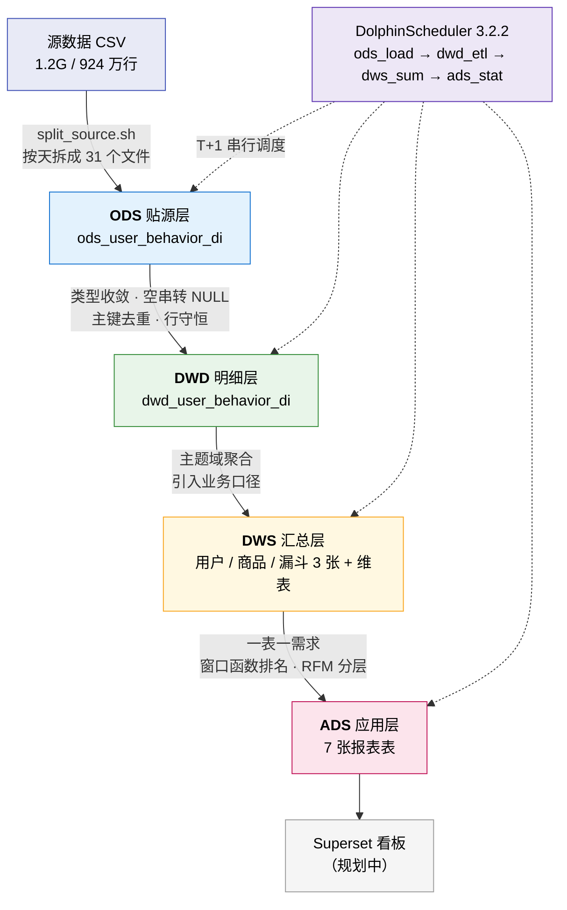

# 电商离线数据仓库（Hive 分层建模 + DolphinScheduler 调度）

基于 924 万条真实电商用户行为日志，在 3 节点 Hadoop/Hive 集群上从零搭建的一套离线数仓。
覆盖 **ODS → DWD → DWS → ADS** 四层，共 13 张表、7 类主题报表，全链路建有跨层校验，
并用 DolphinScheduler 3.2.2 串成 T+1 工作流。

> 说明：本项目为个人学习项目，集群为本地 VMware 虚拟机。所有 SQL 与调度脚本均可复现，
> 真实开发过程中遇到的问题记录在 [`docs/03_踩坑记录.md`](docs/03_踩坑记录.md)。

---

## 一、项目背景

电商场景下，业务方关心的指标（GMV、留存、转化漏斗、用户价值分层）散落在原始日志里，
直接查明细表有三个问题：查询慢、口径不统一、每次都要重写 SQL。

本项目做的是把这些指标**按分层模型沉淀下来**：
明细数据只清洗一次，中间层固化主题粒度，应用层一表对一需求，业务方拿到表就能直接看数。

## 二、数据源

| 项目 | 说明 |
|---|---|
| 数据集 | Kaggle — *eCommerce behavior data from multi category store*（REES46 Marketing Platform） |
| 时间范围 | 2019-10-01 ~ 2019-10-31（31 天） |
| 规模 | 9,244,421 行 / 1.2 GB |
| 字段 | `event_time, event_type, product_id, category_id, category_code, brand, price, user_id, user_session` |
| 行为类型 | `view` 8,855,310 / `cart` 97,954 / `purchase` 291,157 |

**两个必须提前知道的数据事实**（影响所有下游口径）：

1. **数据没有 `quantity` 字段** —— 所以"GMV"严格含义是**成交单价之和**，不是含件数的商品交易总额。本项目所有金额字段的注释里都写明了这一点。
2. **`category_code` 缺失 31%、`brand` 缺失 13%** —— 本项目统一保留为"未知品类/未知品牌"分组，不做丢弃，以保证各表金额加总等于大盘。

## 三、技术栈与环境

| 组件 | 版本 / 说明 |
|---|---|
| Hadoop | **3.1.3**（HDFS + YARN，3 节点：hadoop1 为 NameNode + ResourceManager，hadoop2/3 为 DataNode + NodeManager） |
| Hive | 3.1.2，Metastore 存储在 MySQL 5.7.28 |
| 执行引擎 | MapReduce（Spark 3.1.3 已部署，当前链路未启用） |
| 存储格式 | ODS 为 TEXTFILE（贴源），DWD 及以上为 ORC + Snappy |
| 调度 | **DolphinScheduler 3.2.2**（三节点部署，ZK 3.8.4 做注册中心） |
| 运维 | Bash 运维脚本 `scripts/ops/dw-cluster.sh`（一键启停 + 7 项自检） |
| 集群规格 | 3 台 VMware 虚拟机，每台 5.7 GB 内存，JDK 8 |
| 语言 | Hive SQL + Bash |

## 四、分层架构



### 各层职责与表清单

| 层 | 表 | 粒度 | 行数 | 说明 |
|---|---|---|---|---|
| **ODS** | `ods_user_behavior_di` | 原始明细 | 9,244,421 | 外部表，全 STRING 贴源零加工，按 `dt` 分区 |
| **DWD** | `dwd_user_behavior_di` | 一行一次行为 | 9,244,421 | 类型收敛 + 去重 + 空值处理，**与 ODS 行数守恒** |
| **DWS** | `dim_user_first_active` | 用户 | 3,021,953 | 首活日维表 |
| | `dws_user_action_day` | 用户 × 天 | 6,444,006 | |
| | `dws_product_action_day` | 商品 × 天 | 1,267,028 | |
| | `dws_user_funnel_day` | 天 | 31 | 同日漏斗 |
| **ADS** | `ads_trade_overview_day` | 天 | 31 | 大盘日报 |
| | `ads_user_funnel_day` | 天 | 31 | 漏斗与新老人群结构 |
| | `ads_user_retention_day` | 新增日（cohort） | 31 | 留存分析 |
| | `ads_product_rank_day` | 天 × 排名 | 1,550 | 商品 TOP 50 |
| | `ads_category_sales_day` | 天 × 品类 | 3,843 | 品类分析（含一级品类下钻） |
| | `ads_brand_sales_day` | 天 × 品牌 | 930 | 品牌 TOP 30 |
| | `ads_user_value_rfm` | 用户 | 3,021,953 | RFM 价值分层 |

> 13 张表 = ODS 1 + DWD 1 + DWS 4（含 1 张维表）+ ADS 7。

## 五、核心口径

完整口径字典见 [`docs/02_指标口径字典.md`](docs/02_指标口径字典.md)，这里列三个最容易讲错的点：

**1. GMV** —— 无 `quantity` 字段，实为"成交单价之和"，非含件数的商品交易总额。所有金额字段注释均已标注。

**2. 加购→支付转化率恒大于 1** —— 这不是 SQL 写错。源数据里 `cart` 事件仅占 1.06%，`purchase` 占 3.15%，大量用户浏览后直接下单、不经过加购。所以"加购→支付"不是主转化路径，主指标应看 `view_to_pay_rate`；`strict_funnel_users`（真正走完浏览→加购→支付三步的人数）才能反映加购环节的真实损耗。

**3. 数据集首日的新用户是"伪新客"** —— 数据从 2019-10-01 开始，这天所有存量用户都会被判成新用户。实测该日"次日留存"8.44%，明显高于其他日期的 4~6%，正是因为这批人根本不是新客。留存表用 `is_data_start_cohort` 字段标记了该 cohort，看数时应排除。

## 六、六个关键设计决策

| # | 决策 | 原因 |
|---|---|---|
| 1 | ODS 用**外部表** | 误删表不会连带删掉 HDFS 上的原始数据 |
| 2 | DWD **不做 WHERE 过滤** | 保证 ODS 与 DWD 行数严格守恒（9,244,421），清洗逻辑可审计 |
| 3 | 首活日**固化成维表** | 现算 `MIN(dt)` 要全表扫描；且倒序补数时会算错——先跑 10-05 再跑 10-01，10-01 会被误判成老用户 |
| 4 | 日常增量与历史补数**两套 SQL** | 按天循环 31 天需 143 分钟；改成 `GROUP BY dt` + 动态分区批量补数，438 秒完成（快约 19 倍） |
| 5 | 留存**观察窗口不足置 NULL** | 数据仅 31 天，靠后的 cohort 算不出 15/30 日留存，宁可空着也不拿部分数据凑数 |
| 6 | RFM **三个分数用三种打分法** | R 固定区间（跨月可比）；F 固定区间（离散小整数，NTILE 会把并列值随机切进不同桶）；M 用 NTILE 等频但**只对有购买行为的用户分桶**，否则 281 万未购买用户会挤满第 1 桶、让所有购买用户分数失真 |

## 七、调度与运维

### 7.1 DolphinScheduler 工作流

```
ods_load  →  dwd_etl  →  dws_sum  →  ads_stat
 (ODS)       (DWD)       (DWS)       (ADS + 7 条校验)
```

| 配置项 | 值 | 说明 |
|---|---|---|
| 部署角色 | hadoop1：master / api / alert；hadoop2、hadoop3：worker | hadoop1 已承载 NameNode + RM + MySQL，不再放 worker |
| 全局参数 | `bizdate = $[yyyy-MM-dd-1]` | T+1 跑昨天；内置 `${system.biz.date}` 是 `yyyyMMdd`，与 `dt=2019-10-01` 不匹配 |
| 租户 | `cy` | 必须选真实 Linux 用户，`default` 是占位租户，任务会被直接拒绝 |
| 工作流失败策略 | **结束** | 上游失败就不跑下游，保住分层依赖 |
| 定时失败策略 | **继续** | 避免一次失败让定时永久停摆 |
| 负载保护 | system-mem 0.90（hadoop1 侧 0.95） | 默认 0.7 在 5.7G 虚拟机上会持续拦截任务 |

**一个必须记住的换算**：补数填的是**调度日**，`bizdate` 还要再减一天。
跑业务日期 `2019-10-01`，补数日期要填 `2019-10-02`。

工作流定义已导出为 [`scheduling/ecommerce_workflow.json`](scheduling/ecommerce_workflow.json)，
在 DS「工作流定义 → 导入」中可直接还原四个节点与依赖关系（前提：脚本已部署到 `/home/cy/scripts/`）。

> 完整部署过程、首次运行失败实录与排障命令见 [`docs/05_DolphinScheduler部署手册.md`](docs/05_DolphinScheduler部署手册.md)。

### 7.2 集群运维脚本

```bash
bash scripts/ops/dw-cluster.sh start     # ZK → HDFS/YARN → 等 safemode 退出 → DS master/api/alert → worker
bash scripts/ops/dw-cluster.sh check     # 7 项自检：ZK quorum / MySQL / HDFS / YARN / DS 进程 / 端口与 UI / OverLoad
bash scripts/ops/dw-cluster.sh status
bash scripts/ops/dw-cluster.sh stop
```

`check` 覆盖了"进程在、服务却不可用"的典型情况：DS 五个进程 RUNNING、UI 返回 200、
HDFS 退出安全模式且 DataNode 3/3、最近 10 分钟无 OverLoad 拦截，才判定集群健康。

## 八、快速开始

前置：Hadoop + Hive + DolphinScheduler 集群可用，脚本部署到各节点的 `/home/cy/scripts/`，
源数据放到 `~/project/data/`。

```bash
# 0. 启动集群并自检（ZK / HDFS / YARN / DS 一次拉起）
bash scripts/ops/dw-cluster.sh start

# 1. 拆分源数据：按天拆成 31 个文件，去表头去 \r，产出行数基准清单
bash scripts/ods/split_source.sh

# 2. ODS：建库建表 → 上传并建立分区（幂等，重复执行行数不变）
hive -f scripts/ods/ods_ddl.sql
bash scripts/ods/ods_load.sh

# 3. DWD：建表 → 全量转换（单天用 bash scripts/dwd/dwd_load.sh 2019-10-01）
hive -f scripts/dwd/dwd_ddl.sql
bash scripts/dwd/dwd_load.sh all

# 4. DWS：建表 → 全量汇总（首次会自动重建首活日维表）
hive -f scripts/dws/dws_ddl.sql
bash scripts/dws/dws_load.sh all

# 5. ADS：建表 → 全量产出
hive -f scripts/ads/ads_ddl.sql
bash scripts/ads/ads_load.sh all
```

每个 `*_load.sh` 跑完会自动执行该层的校验，全部通过才会打印 `[PASS]`，否则以非 0 退出码结束，
可被调度系统捕获。

> 历史回填走命令行的 `all` 模式（批量 SQL 比按天循环快约 19 倍），逐层耗时见
> [`docs/04_运行与校验手册.md`](docs/04_运行与校验手册.md) 第四节。
> 不要用调度补数一次性跑 31 天——ADS 的留存表与 RFM 表每次都要全期重算，
> 单天全链路实测约 30 分钟，31 天按天跑要十几个小时。

## 九、校验体系

数据分层最大的风险是"某一层算错，下游报表跟着错且没人发现"。本项目每层都建了跨层反查：

| 层 | 校验规则 |
|---|---|
| ODS | 各分区行数与拆分清单 `_manifest.txt` 逐日比对；重复上传行数不变（幂等） |
| DWD | ① ODS 行数 = DWD 行数 ② 主键组合唯一 ③ 输出文件数检查 |
| DWS | ① 用户表 GMV = 商品表 GMV（逐日） ② 两表订单数逐日相等 ③ 漏斗表每天恰好 1 行 ④ 行数 = DWD 去重数 |
| ADS | ① 大盘 GMV = DWS GMV = 74,948,758.44 ② 订单数 = 291,157 ③ **每个 `dt` 分区恰好 1 行**（无重复日期）；单天模式额外校验目标分区已产出，全量模式校验覆盖 31 天 ④ 品类 GMV 合计 = 大盘（证明未知分组没丢数） ⑤ 新客+老客下单人数 = 支付人数 ⑥ 留存 cohort 数与窗口约束 ⑦ RFM 用户数 = 维表用户数 |

## 十、数据结论

| 指标 | 值 |
|---|---|
| 全月 GMV | ¥74,948,758.44 |
| 订单数 | 291,157 |
| 活跃用户 / 商品 | 3,021,953 / 142,473 |
| 客单价 / ARPU | 227~296 元 / 9.7~17.1 元 |
| 浏览→支付转化率 | 3.5% ~ 5.1% |
| 次日留存 | 4% ~ 8%（首日 cohort 除外，见上文口径 3） |

**业务洞察：**

- **GMV 高度集中**：`electronics.smartphone` 单品类占全月 64.23%，未知品类占 11.2%，其余百余个品类合计不足 25%
- **10-14 是月度峰值**（GMV 355 万），10-15 加购数达月内最高（5,515）
- **用户价值集中在少数人**：仅 11,025 人（占活跃用户 0.36%）贡献了 1,596 万 GMV；93.1% 的用户全月未产生购买
- **ORC + Snappy 压缩效果**：DWD 层 459.8 MB，相比 CSV 源数据 1.1 GB 节省约 58%

## 十一、项目结构

```
.
├── README.md
├── .gitattributes            # 行尾统一为 LF，避免 Shell 脚本出现 bad interpreter
├── .gitignore
├── docs/
│   ├── 01_分层设计与建模.md
│   ├── 02_指标口径字典.md
│   ├── 03_踩坑记录.md
│   ├── 04_运行与校验手册.md
│   ├── 05_DolphinScheduler部署手册.md
│   ├── 06_ADS性能诊断与优化方向.md
│   ├── 07_ADS_SQL优化方案.md    # 6 步改造，目标 1330 s → 550 s
│   └── notes/                # 学习笔记
│       ├── knowledge/        # 整理过的知识卡（分层思维 + Hive/MySQL/ZK/DS/Shell）
│       └── *.md              # 早期原始笔记（部分路径为旧版）
├── scripts/
│   ├── ods/    split_source.sh · ods_ddl.sql · ods_load.sh · ods_add_partition.sql
│   ├── dwd/    dwd_ddl.sql · dwd_etl.sql · dwd_load.sh
│   ├── dws/    dws_ddl.sql · dws_dim_user.sql · dws_etl_day.sql · dws_backfill.sql · dws_load.sh
│   ├── ads/    ads_ddl.sql · ads_etl_day.sql · ads_backfill.sql
│   │           ads_retention.sql · ads_rfm.sql · ads_load.sh
│   └── ops/    dw-cluster.sh          # 集群一键启停 / 7 项健康自检
├── scheduling/
│   └── ecommerce_workflow.json        # DS 工作流定义，可在 UI 直接导入
└── data/
    └── sample/ecommerce_events_sample.csv   # 1 万行样本，供快速验证
```

## 十二、后续规划

- [x] **DolphinScheduler 调度**：4 节点串行工作流已上线，全局参数 `bizdate` 支持 T+1 与补数
- [ ] **定时调度**：配置每日 02:10 的 cron 与告警（工作流已就绪，定时任务尚未启用）
- [ ] **Superset 可视化**：接入 HiveServer2，把 ADS 七张表做成看板
- [ ] **ADS SQL 优化**：校验合并、RFM/留存窗口裁剪、中间表消除重复扫描（[`docs/07`](docs/07_ADS_SQL优化方案.md)），目标 ADS 1330 s → 550 s
- [ ] **DIM 维度层**：扩展 `dim_user_first_active` 为完整用户维度，品类维度补 SCD2 缓慢变化维
